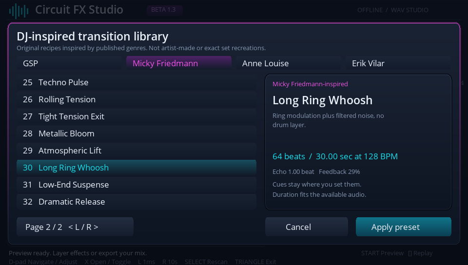
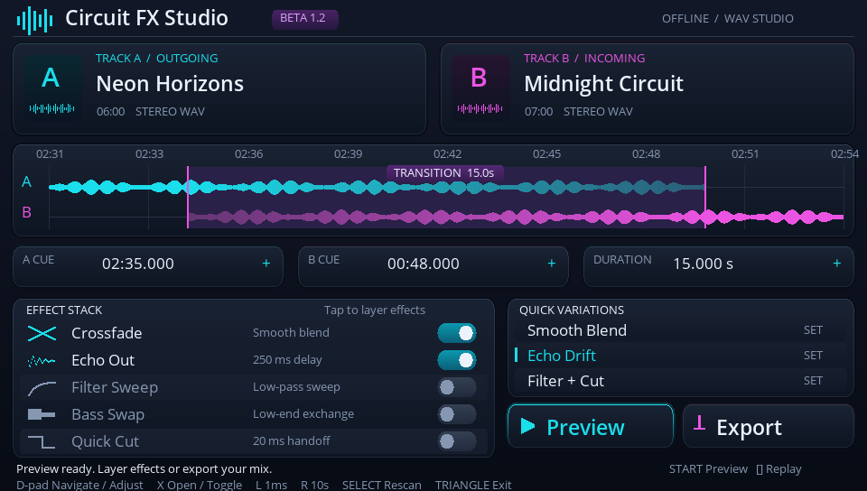

# Circuit FX Studio — native PS Vita Beta 1

A standalone VitaSDK DJ transition editor for **960×544**. Replaces the PSP target. No PC, server, Adrenaline, overclock, or extra runtime plugins are needed for mixing.

## Beta 1.9 — waveform-first interface (01.09)

The dashboard now follows the supplied dark cyan/magenta reference at native Vita resolution. Compact Track A/B selectors sit above a shared, zoomable two-track timeline that occupies about half the display. Drag the waveform to pan, pinch or use +/− to zoom, tap FIT for the full available song range, and drag each cue marker. Both songs' transition intervals and endpoints are shaded directly on their waveforms. The existing cached 8,192-bin envelopes are reused; switching tabs never decodes or rescans songs.

Below the timeline are Preview/Stop/Replay, precise A/B cue and duration editors, zoom controls, Export, and three tabs. **Transitions** chooses one of the five core transition types; selecting Echo, Filter or Bass also retains the smooth crossfade handoff, while Quick Cut uses its existing 20 ms handoff. **Effects** lets you toggle and combine the five manual effects and change global effect intensity. **Presets** organizes all 128 existing recipes in eight categories, including 25 bundled WAV sounds and their reverse variants. Select a card, then Detail / Apply to audition WAV effects, adjust reverse/speed and apply the preset. Preset BPM is adjustable in its tab.

The illustrated curves show the behavior of existing effects, not an editable curve parameter. The reference's per-effect Mix knob and album-art tiles are not implemented: the mixer exposes global effect intensity, while album art has no current loader. Seven advanced modifiers (gate, roll, ring, noise, dip, stereo echo and high-pass) remain available through their existing presets rather than separate manual toggles. No audio DSP or export path was changed.

GPU batched waveforms and cached curve vertices keep drawing work bounded. Host layout/touch checks and audio tests pass; Vita touch feel, actual frame times, playback/export and shell stability still need an on-device stock-clock check.

## Beta 1.8 — Vita2D, lazy MP3 import and full-song waveforms (01.08)

The 960×544 interface now draws through Vita2D: GPU gradient panels, cached glyph atlases and batched waveform bars replace the software framebuffer. It redraws on state changes and uses the Vita's normal clock. Touch targets and all effect controls remain in place.

Choosing an uncached MP3 now probes its length and shows the song without writing a full decoded WAV. A low-priority, cancellable worker builds a compact full-song waveform envelope directly from MP3 frames; WAVs use a sequential scan. Both 8,192-bin envelopes persist in the bounded cache and load without rescanning on later launches. Drag a waveform horizontally, pinch to zoom, or drag its white cue marker. Each deck keeps its own view. The envelope is an approximate visual peak summary; cue times and audio mixing retain millisecond values.

The first preview of an uncached MP3 still creates a 44.1 kHz stereo PCM cache for the existing accurate mixer, then reuses it for later previews and export. This keeps the preview/export DSP path and sound quality identical to 01.07. Conversion can be cancelled with Circle or a touch on its dialog. MP3 duration probing can still scan a file without a VBR duration tag; cached PCM and envelopes are fast paths. UI CPU submission time, waveform build times, cache hits and render times are written to `ux0:data/CircuitFX/session.log`. Real frame time, pinch behavior, audio and suspend/close stability require a Vita check at stock clocks.

## Beta 1.7 — faster browsing and persistent audio cache (01.07)

Song browsing and MP3 conversion no longer redraw the whole interface continuously. The browser redraws on navigation, and the main dashboard sleeps between input events. Cue and effect changes rebuild the timeline from the in-memory waveform envelope instead of re-opening and seeking through both song files. Per-track waveform envelopes are cached too.

MP3 conversion runs on a worker thread. The screen continues polling physical controls and touch; Circle or tapping the progress dialog cancels. A successful conversion is reused across launches and when the same MP3 is loaded on both decks. Cache entries are keyed by path, size and modification time, and the app evicts least-recently-opened reusable entries above **512 MiB**. Selected songs stay pinned while loaded, so active files can temporarily push total storage above that target. Cache files are kept on clean exit; stale `.part` files are removed on launch.

`session.log` includes `TIMING` entries for scans, song selection, MP3 import/cache hits, waveform generation/cache hits, timeline regeneration, preview/export rendering, and the number and CPU time of screen draws. Those measurements are Vita-specific and need to be collected on hardware.

## Beta 1.6 — MP3 song import (01.06)

The song browser now lists `.mp3` and `.wav` files. MP3s are decoded to temporary 44.1 kHz, stereo, 16-bit PCM WAVs when selected, then use the same cue, preview, effects and WAV-export pipeline as WAV songs. Mono and stereo MP3s from 8 to 48 kHz are resampled. MP3 originals are never modified.

- Copy songs into `ux0:data/CircuitFX/music/`, then press SELECT to refresh.
- In Beta 1.6, the first selection of an MP3 showed conversion progress; Circle canceled it. Beta 1.7 replaces that temporary behavior with a persistent bounded cache.
- Compressed MP3s can be at most 64 MB. The temporary decoded WAV uses about **10.1 MiB per minute per track**, so leave room for both caches and the exported mix. Conversion stops cleanly if storage runs out.
- The decoder supports ordinary MPEG Layer III files. Damaged or unsupported inputs return an error without changing the original song.

This beta does not read album art or track metadata from MP3 tags.

## Beta 1.5 — 25 real WAV effects and 128 transition recipes (01.05)

The **WAV FX** tabs include 25 one-shot sounds: 8 whooshes, 6 risers, 6 glitches, and 5 impacts. You can listen to them on their own with no songs loaded, then add one to your two-song transition. The package includes the actual audio; no separate sample download is needed.

- Touch **Browse WAV sounds + presets**, then one of the **WAV 1 / WAV 2** tabs. **Listen WAV** or Square auditions it; Circle, START or a touch stops it.
- Tap **Reverse** to reverse the selected effect. Touch **− / +** to change its speed from 0.5× through 2.0× in 0.1 steps. Speed changes pitch and duration. The audition, rendered preview and WAV export use the same direction and speed.
- Touch **Apply preset** to use the effect with your songs. Effects combine with Echo Out, Filter Sweep, Bass Swap and Quick Cut. FX intensity adjusts the sampled sound level.
- Whooshes, glitches and impacts sit in the middle of the overlap; risers land on its end. When a sound is too long, the app crops it and fades the edge. Slow playback stretches it naturally, and fast playback shortens it; no pitch-preserving time stretch is claimed.
- DAEDAL's CC0 pack supplies the actual audio files. It contains no recordings of the DJs. [Source, license and file hashes](assets/sfx/SOURCE.md).

The four existing genre-informed DJ banks remain, and two researched recipe banks were added: **DJ Paulo** and **Honey Dijon**. Paulo is described as gay by the Washington Blade. Honey Dijon is a trans, queer house DJ; I describe her this way rather than labeling her gay. Each bank has original recipes inspired by published genre and artist context. The effect chain values are our design choices, not claims about these DJs' exact mixes or settings. See [research and sources](docs/DJ_RESEARCH.md) and [the recipe catalog](docs/PRESET_CATALOG.md).

Real Vita hardware is still needed to verify touchscreen controls, sample audition quality and install/upgrade behavior. See the [hardware checklist](HARDWARE_TESTING.md).

## Beta 1.3 — 64 DJ-inspired recipes (01.03)

Open **Browse DJ-inspired presets** in the right panel. Four banks have 16 original recipes each: GSP, Micky Friedmann, Anne Louise, and Erik Vilar inspired. These are genre-informed designs, not exact artist techniques or endorsed presets. See [research and sources](docs/DJ_RESEARCH.md) and [all 64 recipes](docs/PRESET_CATALOG.md).

- Tap an artist tab and a recipe to inspect it; tap Apply preset. D-pad left/right selects banks, up/down recipes, L/R switches pages, X applies, Circle cancels.
- Set **Effect BPM** (60–200) before applying a recipe. Its recommended beat length converts to seconds. Echo, pulse and roll rates use this BPM. **This does not detect beats, change either song's speed, or automatically align tracks.** If BPM is changed later, FX timing changes but the existing transition duration stays fixed; reapply the recipe to update its recommended duration.
- Cues are preserved. If the recipe is too long for the available audio it is shortened, with a status message. Cues at the end of a song must be moved earlier first.
- **FX intensity** (0–100%) adjusts echo, filters, bass cuts and the recipe's special modifiers; it is not master volume and does not remove the gain handoff or change its curve.
- Every recipe supports the same preview and full WAV export. You can still toggle the five basic effects. Extra recipe modifiers stay active until a different recipe is chosen; pick a plain blend recipe to clear them.
- New effects include stereo feedback echoes, high-pass lifts, source-slice rolls, rhythmic gates, ring modulation, electronic noise sweeps and dip envelopes. No drum samples or artist recordings are added.
- At that beta stage, WAV input was 44.1 kHz stereo 16-bit PCM. Automatic beatmatching is still not included.



## Beta 1.2 interface update (01.02)

- Redesigned native dashboard with rounded panels, multiple font sizes, effect icons, switches and cyan/magenta track styling.
- Shared sampled-waveform timeline aligned to both cue times, with shaded transition bounds and an animated preview playhead.
- Tap a cue/duration field (or press X when focused) to enter seconds precisely on a touch keypad. Circle cancels; X applies. D-pad adjustment remains available.
- Three real effect combinations: Smooth Blend, Echo Drift, Filter + Cut. These change the effect stack; preview renders the selected combination.
- Touch song selection, browser page controls, export confirmation and preview stop.
- Audio now runs on a dedicated worker while the interface animates. Physical Vita testing is still required, especially repeated preview/stop and shell interruptions.



## Installation rebuild (01.01)

The first package accidentally contained 2-bit indexed LiveArea PNGs. This rebuild forces 8-bit indexed PNGs and checks both bit depth and color type in the final VPK. Physical Vita installation still requires confirmation.

## Install

1. Copy `CircuitFX-Beta1.vpk` to your homebrew-enabled Vita and install with VitaShell.
2. Launch once to create the folders, then exit with Triangle.
3. Put songs in `ux0:data/CircuitFX/music/` using VitaShell USB or FTP.
4. Launch Circuit FX Studio. Select Track A and Track B.

**Input:** Up to 512 `.wav` or `.mp3` files directly inside the music folder. WAV requires 44,100 Hz, stereo, signed 16-bit PCM. MP3 is decoded on selection and resampled to that format; mono/stereo 8–48 kHz files up to 64 MB are supported. Mono, 48 kHz, float and 24-bit WAV remain unsupported. Unsupported files show an error rather than playing incorrectly. Non-ASCII filename characters display as `?` but paths retain original bytes.

## Make a mix

- D-pad up/down: select a control. X: open a song picker, toggle an effect, preview, or export.
- D-pad left/right on A cue / B cue / duration: adjust by **0.1 second**. Hold **L** for **1 millisecond**, **R** for **10 seconds**. Holding a direction repeats.
- Touch a deck, effect or action to activate it; touch a time field to focus it and adjust with D-pad. The file picker supports touch selection, previous/next pages, and D-pad/X.
- START: render and play a preview. Square: replay the current preview.
- Circle: cancel rendering, stop playback, close a picker, or cancel export confirmation.
- SELECT: refresh the song list. Triangle: cleanly exit from the dashboard.
- Vita hardware volume buttons control listening volume.

The **A cue** is where the transition starts in the outgoing song. The **B cue** is where the incoming song begins. Both cues plus duration must fit within their songs. Duration: **0.100–120.000 seconds**. Cue positions map to the nearest audio frame; duration maps to complete frames.

Export consists of **A [0 → A cue], then the overlap, then B [B cue + duration → end]**. A after the overlap and B before its cue are intentionally omitted. Preview contains up to four seconds before and after the transition and uses the same renderer/settings as export. Any settings change invalidates the old preview. Preview is required before export; export asks for X confirmation.

## Five stackable effects

| Effect | Beta 1 behavior |
|---|---|
| Crossfade | Linear complementary A/B gain envelope. |
| Echo Out | 250 ms delay on A, 35% feedback, wet level grows to 30% during overlap. |
| Filter Sweep | A low-pass sweep from 18 kHz toward 220 Hz, blended in over the transition. |
| Bass Swap | Low-frequency separation at approximately 150 Hz; progressively removes A bass and introduces B bass. |
| Quick Cut | Switches A to B at overlap midpoint with a short 20 ms click-reduction ramp. Overrides the crossfade envelope while other effects remain active. |

Toggle any combination. With Crossfade off, a short midpoint handoff is used. The original manual stack has fixed base parameters; Beta 1.3 recipes supply tuned parameters and global intensity. In all modes, all processing is baked into preview/export. Final samples are saturated to prevent integer wraparound. Echo tails end with the overlap.

Exports are numbered `ux0:data/CircuitFX/exports/MIX0001.WAV`, etc. Existing files and source songs are not overwritten. Cancellation and failed writes remove partial output. Outputs are capped below 2 GiB. Budget about **180 MB free** for a 14-minute mix plus the longest preview. Rendering streams fixed-size buffers, so RAM does not grow with song length. The temporary preview is removed on clean exit and on next launch after a forced close.

## Build and validation

GitHub Actions runs host audio and MP3 import tests, sanitizer checks, UI compilation, VitaSDK build and VPK structure checks on every push. Download the `Circuit-FX-Studio-Vita-Beta1.8` artifact from a successful run. The workflow pins the SDK archive and SHA-256 and installs Vita2D at build time. minimp3 and Vita2D are compiled into the app; they add no runtime plugin.

Local Vita build:

```sh
export VITASDK=/path/to/vitasdk
export PATH="$VITASDK/bin:$PATH"
cmake -S . -B build
cmake --build build --parallel 2
python3 tests/check_vpk.py build/CircuitFX-Beta1.vpk
```

Host tests:

```sh
gcc -std=c99 -O2 -Wall -Wextra -Werror -DHOST_TEST src/render.c src/wav.c src/presets.c -lm -o tests/render
python3 tests/test_audio.py
gcc -std=c99 -O2 -Wall -Wextra -Werror -Isrc -Ithird_party/minimp3 src/mp3_import.c src/wav.c tests/mp3_convert.c -lm -o tests/mp3_convert
python3 tests/test_mp3.py
```

The real UI can also render on a host with `gcc -O2 -DHOST_UI -Isrc vita/ui.c src/presets.c -lm -o /tmp/ui && /tmp/ui` (writes `ui-preview.ppm`). Font raster data is bundled; regeneration needs Pillow and Open Sans. See `assets/FONT-LICENSE.txt`.

**Not included:** automatic tempo/beat matching, BPM detection, user-saved presets, album artwork, a draggable timeline, or background/locked-screen playback. The timeline shows sampled source peaks aligned to the cues; it is not a draggable or zoomable editor. Its colors illustrate the gain handoff, not a sample-accurate post-effect waveform. The reference image informs the dark cyan/magenta dashboard, but its extra controls are not shown as fake features.

This is a compiled, host-tested **hardware-test beta**, not a claim of verified playback on a physical Vita. See [HARDWARE_TESTING.md](HARDWARE_TESTING.md). Diagnostic messages are recorded in `ux0:data/CircuitFX/session.log` (reset on launch).
